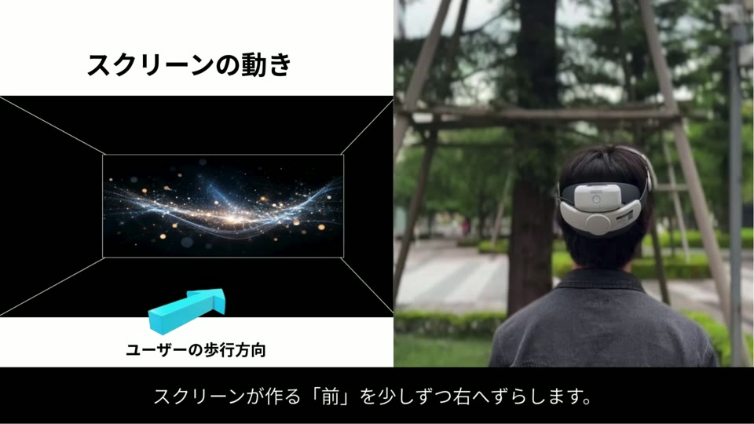

# DriftWalk Theater

映像と身体感覚を組み合わせるVR体験のビデオプロトタイプ。

[作品を見る](https://eisuke29.github.io/portfolio/work4.html) · [ポートフォリオ](https://eisuke29.github.io/portfolio/)



## 作品について

HMDの映像とGVSによる身体感覚を組み合わせる体験を提案したビデオプロトタイプです。実装済みのVRアプリではありません。2026年6月12日のゼミ中間発表で公表。Canvaを中心に制作し、一部素材はPowerPointで作成しました。

[完成映像（MP4）](media/film.mp4)

## ローカルで動かす

このリポジトリのフォルダで次を実行し、http://localhost:8000/ を開きます。

```sh
python -m http.server 8000
```


## 制作者・権利

木下瑛介 / Eisuke Kinoshita（[Eisuke29](https://github.com/Eisuke29)）。共同制作・外部素材については上記の説明を参照してください。自作のコード・映像・デザインについて、別途記載のない限り無断での再配布は許諾していません。外部ライブラリ・モデル・フォント等にはそれぞれのライセンスが適用されます。
